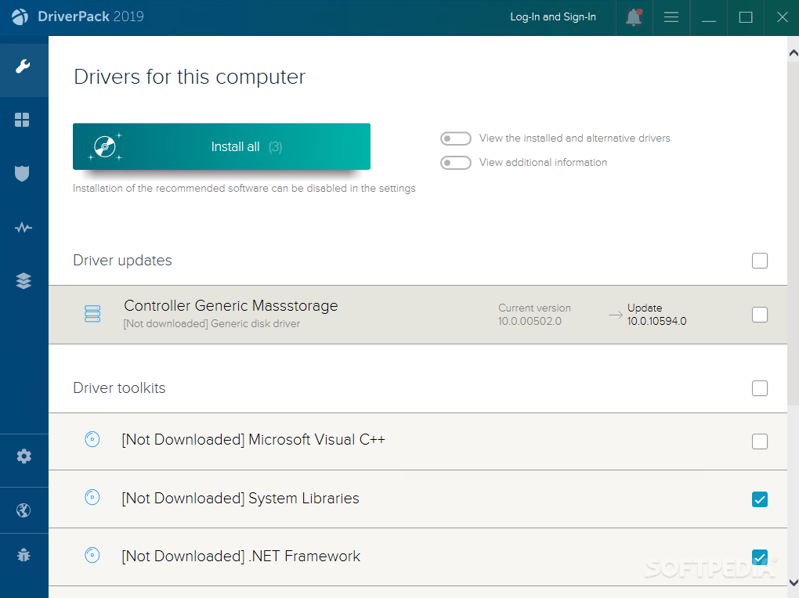
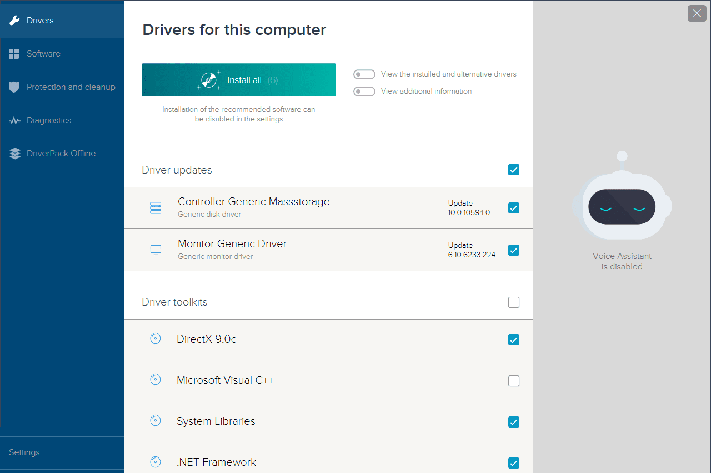
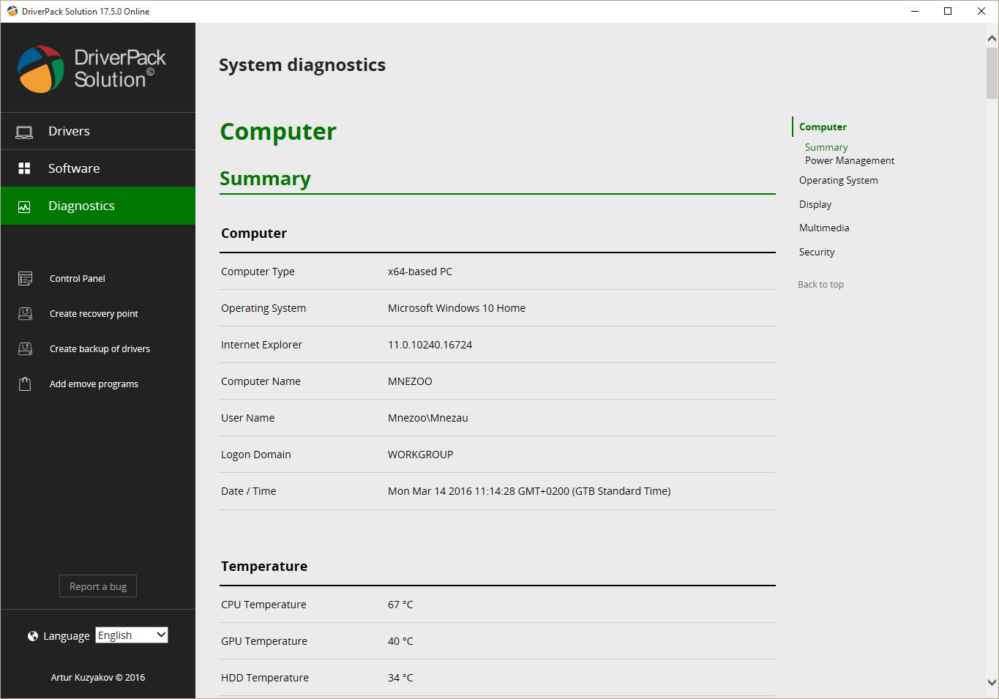

# DriverPack Solution Offline

DriverPack Solution is a free Windows tool that scans the PC, finds missing or old device drivers, and installs the packages that match. People shorten the name to drp solution. The publisher site is driverpack io.

There are two ways to run it. driverpack solution online is the small build: it looks at the hardware, then downloads only the packages that machine needs. DriverPack Solution Offline is the large build: the driver database sits on the disk or on a USB stick, so a PC with no network can still be repaired.

The usual reason to open the offline build is a clean install where the network adapter has no driver yet. Until that adapter works, the online build cannot fetch anything.

## Caution

The installer has a history of offering extra software next to the drivers. During setup, choose the drivers-only path and decline toolbars, browsers, and other add-ons you did not come for. If a page asks you to turn off antivirus for the whole install, stop and read what is about to run.

A bulk installer can put the wrong package on a working device. DriverPack Solution can save a backup of the current drivers before it writes new ones. Make that backup before a wide pass, especially on the only storage controller or the only network adapter.

Search traffic for driverpack solution safe exists because of those extras, not because the driver database itself is a substitute for Windows Update. On a PC that already has a working network, the vendor site or Windows Update is the calmer path. Use this tool when those paths cannot see the hardware.

A backup is a copy of the packages already on the machine. It is not a full image of the disk. Documents and photos stay where they are.

Keep the PC awake while the backup and the install run. Sleep in the middle can leave a device with no package until the next boot.

If the only network adapter is the one you are about to replace, finish that row before you touch audio or the webcam. You can download a vendor package later only if that adapter still works.

## What DriverPack Solution keeps

The app keeps a catalog of device packages and a list of what this PC is using now. A row has a device name, a class, a version, and a date. Classes you will see often are network, audio, display, chipset, and USB.

The store of packages already accepted by Windows is read in [DriverStoreRepository.cs](store/DriverStoreRepository.cs). Whether a device is plugged in right now, rather than only present as a file on disk, is decided in `DeviceHelper.cs`.

The offline database is not a second operating system. It is a set of driver packages plus an index. The index code is [driver_index.rs](index/driver_index.rs), and the native index beside it is [indexing.cpp](index/indexing.cpp).

## Introduction

DriverPack Solution is aimed at a desk where many PCs pass through: a repair bench, a lab, a shop that reinstalls Windows all week. One offline copy can serve machines that never reach the internet.

The online build is the better fit for a single home PC that already has a connection and only one or two devices missing. It does not ask you to carry tens of gigabytes of packages you will not use.

Both builds are free. This page does not add a paid tier and does not list a price. DriverPack Solution Offline and the online build are editions of the same product, not two competing brands.

Windows coverage in the product description runs from Windows XP through Windows 11, in 32-bit and 64-bit. A phrase such as driverpack solution windows 10 or driverpack solution windows 11 is the same app pointed at that system, not a separate download family you have to hunt for.

The offline edition is the one you copy once and carry. The online edition stays small because it does not contain the database.

A shop can keep the offline copy on a bench disk and still use the online build on a PC that already has Wi-Fi. They are not mutually exclusive. They are two ways to feed the same list.

Do not mix a random ISO from a file host into that bench disk. If the file name adds a crack or a year you did not choose, it is not the publisher package.

## Features

### Core Operations

One pass has five moves.

1. Read the devices Windows can see.
2. Match them to the catalog, online or on disk.
3. Back up the drivers that are already installed.
4. Install the rows you confirmed.
5. Leave a note of what changed, so you can put a package back.

Matching for the index lives in [driver_match.rs](match/driver_match.rs). The older matcher beside it is [matcher.cpp](match/matcher.cpp). The device record is `device.h`.

Do not tick every row on a laptop you need the same day. One class at a time leaves you a working machine if a match was wrong. Network first, if that is why you booted the offline copy. Sound and the webcam can wait.

Hardware ids are the string Windows prints for the device. Trust that id when two boxes share a brand.

A skipped row stays on the current package. Skipping is the right result when the only newer file is one you did not bring yourself and you do not want the database copy.

After a reboot, open Device Manager if the list and the device disagree. Believe Device Manager, then scan again.

### Advanced Capabilities

The online build and the offline build share the confirm step. A package that was already on a USB disk still should not install itself with no prompt. DriverPack Solution Offline is large so you can work without a network, not so the app can skip the question.

Install after a match is [install_driver.rs](install/install_driver.rs) and [install.cpp](install/install.cpp). A later refresh of the catalog copy is `update.cpp`. Adding or removing a package Windows has already stored goes through [PNPUtil.cs](store/PNPUtil.cs).

You can export the list as text. That snapshot is `CSVExporter.cs`. It is names and versions, not a second installer.

The app can also target a Windows folder that is not the system you booted, for a disk on the bench. That path is for a technician who already knows the image. A home PC should stay on the running system.

Wifi, audio, and chipset are the classes people name most often in search. They are still just rows in the same list. A Wi-Fi package does not install the sound device.

Printer packages are easy to over-install. If the printer is not in the room, leave that class alone. You can add it when the cable is here.

### User Interface

The window is a list you can sort by name, class, version, or date. A filter box narrows the rows while you type. Drawing and list behavior start in [gui.cpp](gui/gui.cpp). The form that hosts the columns is [DSEForm.cs](gui/DSEForm.cs).

The backup editor is the step before a wide install. It shows which current packages will be copied aside. It does not rewrite inf files. If you need a hand-made inf, that work happens outside this list. You return here only to install a finished package.

Column order and the last catalog path are kept in [app.config](app.config). The editor profile for the tree is `settings.json`. The strings for the English UI live in `en.yml`.

Sort by class when you came in for one network problem. Sort by date when you are looking at what the last pass changed.

The log under the list records the backup folder and the package name. It stays on the PC. It does not send the device list anywhere.

If a later boot fails, that package name is the line you want. The backup folder should still hold the previous file.

## Software Architecture

The catalog, the match, and the install are separate. The catalog answers "which file is this hardware id". The match answers "which of those files is newer than what Windows loaded". The install writes only after backup and confirm.

Startup of the native process is [main.cpp](main.cpp). The other entry, for the index tool, is [main.rs](main.rs). The crate manifest is [Cargo.toml](Cargo.toml).

### Driver Matching Rules

A match prefers a package whose hardware id is exact, then a newer version, then a newer date. A marketing name on the box is not an id. Two audio devices can share a brand and still need different packages.

If several packages claim the same id and none is clearly newer, the row stays undecided. Leave the device on the package it already uses. DriverPack Solution should not guess past a tie.

A device with no driver at all outranks a device that merely has an older package. That is the missing-driver case the offline build is for: the network adapter with a yellow mark after a clean install.

A compatible id is weaker than an exact id. The list may show it, and it should not be the default tick. Exact first.

Date is the tie break only after the id matches. A newer date on the wrong id is still the wrong package.

### Driver Sorting Rules

Within one class, newer signed packages sort above older ones. A package you saved from the board maker can sit above the database copy when its date is later. The list marks that row as yours, not as part of the bundled database.

Unsigned files sort last. They stay visible so you can see them. They do not install on a default pass.

A backup copy sorts as history, not as a candidate for a second install. It is there so you can return, not so the next scan offers it as new.

The online catalog and the offline database can both name the same hardware id. The row should show which copy you are about to use before you confirm.

## Driver status and backup

| State | Meaning |
| --- | --- |
| Current | The device already uses the newest package the catalog found |
| Update | A newer package is in the database or online |
| Missing | Windows has no driver for this hardware id |
| Offline only | The package is in DriverPack Solution Offline and was not fetched live |
| Backed up | A copy of the previous package was saved before the write |

| Class | What the scan groups here |
| --- | --- |
| Net | Ethernet and Wi-Fi, including the adapter you need first |
| Media | Sound and HDMI audio |
| Display | The graphics package |
| System | Chipset packages the board wants at boot |
| USB | Hubs, controllers, and devices on a USB port |

The grid is that list grouped by class. Network sits at the top of an offline repair so you are not hunting for it under the printer rows.

Old copies can remain after a newer package is installed. That is what makes a backup useful, and it is also why the driver store grows. Delete old copies only when the new package has survived a reboot and the device still works.

Dimmed names are hardware that was here before and is unplugged. A camera or a USB disk can look idle while the cable is in a drawer. Do not remove those packages unless the device is gone for good.

## Screenshot

The main screen is the grid. Progress stays on the row you confirmed. Backup is a step on that same screen, not a second program you have to find in Control Panel.

A quiet row after install means the device accepted the package. A row that returns to Update means the catalog still has something newer, or the match was refused. Open the row before you run the pass again.

The first paint can take a while when DriverPack Solution Offline is the full database. Wait until the row count settles before you sort. A sort during that fill hides devices you still need.

Pictures on download mirrors are often an older build. Trust the list on your own PC.

Plug the USB device in before the scan if it was absent at launch. A slow gadget can miss the first pass. Run the scan again before you decide the database has no row.

Front-panel ports and rear ports are often the same controller. One row can cover both. A separate hub with its own package is a different row. Read the name before you assume one tick fixes every socket.

## Fetch the edition

### Requirements

- Windows on the PC you are fixing, from the versions the product still describes through Windows 11.
- An account that can approve the install prompt.
- Disk space for the backup, and much more disk space if you chose the offline database.
- For the online build, a working network. For the offline build, the database on a local disk or a large USB stick.

People still search driverpack solution windows 10 64 bit and the Windows 7 phrases. Those are the same product pointed at that system. This page does not split them into separate apps.

### Packaged edition

Download the build from the publisher. One button, one package. Pick online or offline on the publisher page before you start the file.

Choose drivers only when the setup offers extras. A mirror, a repack, or a toolbar bundle is not the publisher build. driverpack io is the name of that publisher site.

### Self-built

The desktop app is shipped as a binary. This tree is the module map: index, match, install, store, the window, and the pack step. It is not a recipe that replaces the packaged edition.

The check profile is `qodana.yaml`. Build entry scripts are `msbuild.yml` and `ci.yml`. If a script fails, use the packaged build on the PC you are fixing. A compiler error is not a missing driver.

Native modules cover the match and the window. The index modules cover the database and the pack step. Settings files at the root name the build. They do not contain your device list.

Carry the offline database and the program together. An index without the packages, or packages without the index, will not fill the list.

Packing a set of packages into one file is [pack_driver.rs](pack/pack_driver.rs). The USB-side helper for a stick you carry to the bench is `usbwizard.cpp`.

## Libraries in the build

Compression, the catalog fetch, and image decode sit under the scan. They are not separate programs you open. The package store itself is Windows. Reading that store from the index tool is [drvstore.rs](store/drvstore.rs).

Nothing in that set replaces the confirm step. A decoded package is still not installed until you accept the row and the backup has a place to land.

Archive code only opens the package so the index can read the hardware id. It does not choose the row for you.

## Project history

The name has been on download catalogs for years, in online and offline editions. Version numbers in old search phrases are old builds, not a promise that this page hosts every year-stamped ISO.

The publisher site remains the place to tell the online build from DriverPack Solution Offline. A file host that also offers a crack, a patch, or a second installer is a different download. Skip it.

Uninstall from Windows may leave a folder behind. Check the install directory and the backup folder after removal if you want the disk clean. That leftover is files, not a second service you have to hunt.

## Credits

Windows is the store the packages land in. The hardware names are the same ones Device Manager already shows. The database is the publisher's collection. This tree explains how an index, a match, a backup, and an install fit together. It does not replace the packaged build.

Audio and Wi-Fi packages are the ones people ask for by name. They still follow the same match, the same backup, and the same confirm. There is no separate installer for sound.

## Acknowledgments

The index format, the window, and the store query come from different code paths gathered here so the layout can be read in one place. They describe the work. They are not a second brand.

Read the class column before a batch. A chipset row and a USB row can sit next to each other and still be a bad pair to update in one click.

Leave a working display row alone when you only opened the app to fix the network. The grid will still show it. You do not have to tick it.

## Related Questions

### What does DriverPack solution do?

It scans a Windows PC, lists devices that are missing a driver or using an old one, and installs a matching package. driverpack solution online downloads those packages as it goes. DriverPack Solution Offline uses a database you already have, which is the point of that edition on a machine with no network.

### Is the DriverPack solution safe to use?

It is free and widely used, and it also has a real habit of offering extra software. Use the drivers-only choice, keep antivirus on, and back up current drivers first. It is a reasonable tool when a fresh install has no network driver. It is a poor default when Windows Update or the vendor site can already see the device.

### Can I download the DriverPack solution for Windows 11?

Yes. The product description includes Windows 11, 64-bit included, alongside older Windows versions. Use the current publisher build rather than a year-stamped repack that only mentions Windows 7 or Windows 10 in the file name.

### Is DriverPack Solution free?

Yes. Both the online build and DriverPack Solution Offline are free downloads. Free does not mean a mirror can add a paid upsell or a second program. If the setup asks for a fee or a bundled suite, you are not on the plain drivers-only path.

## Related Search Terms

DriverPack Solution Offline, DriverPack Solution, drp solution, driverpack io, driverpack solution online, Topics: drivers, driverpacks, windows, installation, offline, updater, backup, device-manager, cpp, csharp, rust, pnp
